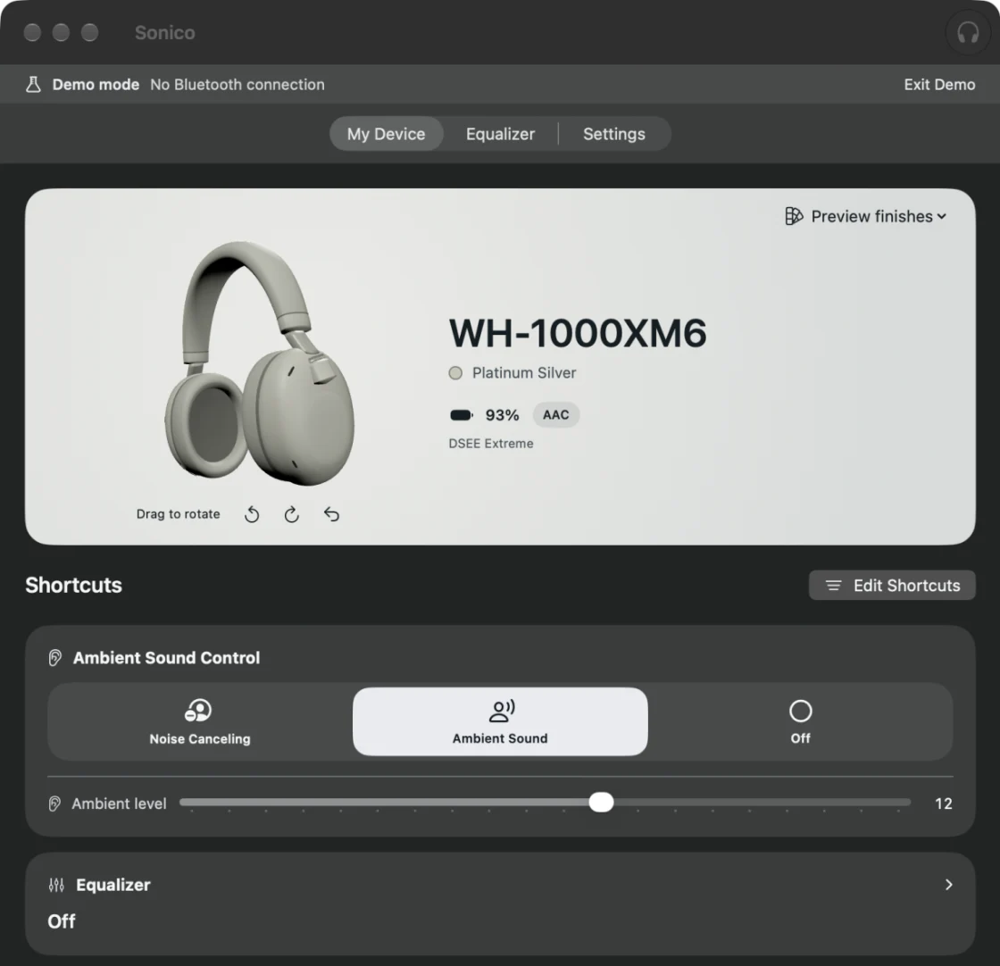

# Sonico

Sony WH-1000X headphone controls for Mac.

**macOS 15+ · Build from source**

[Build and run](#build-and-run) · [Compatibility](#compatibility) · [Credits](#credits)



## Build and run

You’ll need the macOS SDK with Swift 6, CMake 3.31+, and `fmt` 12 installed.

```sh
git clone https://github.com/jfeflores/Sonico.git
cd Sonico
bash macos/build.sh
open build-native/macos/Sonico.app --args --demo
```

The script builds a local, ad-hoc-signed app and runs the offline tests. There’s no notarized download yet. **Demo mode** works without Bluetooth and shows factory preset names only, not personal EQ profiles.

To connect, exit demo mode, pair your headphones in macOS Bluetooth Settings, then choose **Find Paired Headphones** and **Connect** in Sonico. Keep the headphones’ original Bluetooth name so discovery can recognize the model. Connecting reads your EQ without changing it.

## What you can do

- Switch between Noise Canceling, Ambient Sound, and Off. Check your battery and adjust volume from the app or menu bar.
- Read the active EQ and available profiles. On supported models, custom-slot edits aren’t sent until you select **Apply Changes**.
- Reorder or hide controls with **Edit Shortcuts**, and see track details when your headphones report them.
- Rotate the original 3D portrait by dragging or using the rotation buttons. The connection reveal respects Reduce Motion.

## Compatibility

**WH-1000XM6** is the primary target. Sonico also recognizes **WH-1000XM3, XM4, and XM5**. Controls depend on the model and firmware, and live hardware validation is still in progress. See [what’s been tested](docs/macos-validation.md), the [native build and usage notes](macos/README.md), and the [design notes](DESIGN.md). Maintainers can follow the [installer and release checklist](docs/macos-release.md).

## Credits

**What Sonico adds.** [J (@jfeflores)](https://github.com/jfeflores) created the separate SwiftUI/AppKit app, menu-bar controls, EQ workflow, customizable shortcuts, and original 3D portraits and icon. Sonico also adds targeted fixes and tests to the shared libraries.

**What it builds on.** [mos9527](https://github.com/mos9527), [Amr Satrio](https://github.com/Amrsatrio), and the [SonyHeadphonesClient contributors](https://github.com/mos9527/SonyHeadphonesClient) created the inherited protocol libraries, Bluetooth backends, reference client, and tests. [Plutoberth and contributors](https://github.com/Plutoberth/SonyHeadphonesClient) created the earlier project in that lineage. The [reference client](client/README.md) remains separate from Sonico.

Sonico is independent and not affiliated with or endorsed by Sony.

## License

The native app is [AGPL-3.0-only](LICENSE); inherited code retains [MIT](LICENSES/MIT-SonyHeadphonesClient.txt). See [notices and attribution](LICENSES/NOTICE.txt) for scope and third-party terms.
